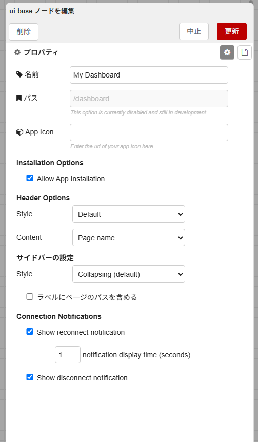

# Node-RED on unkernel

[English](README.md)

[ブラウザでデモを開く](https://utaani.github.io/unkernel-node-red/)


[unkernel](https://github.com/pithings/unkernel) を使って、[Node-RED](https://github.com/node-red/node-red) をブラウザ内で起動するデモです。GitHub Pages が配信するファイルを読み込むと、空の Node-RED エディターが開きます。Node-RED は閲覧者のブラウザ内で動作し、サーバーを用意せずに Node-RED を試せます。

## 試し方

1. WebAssembly JSPI に対応するブラウザでデモを開きます。Chromium 156 で動作を確認しています。デスクトップ版の Chrome と Edge は 137 以降、Firefox は 153 以降、Safari は 27 以降で JSPI に対応しています。JSPI が利用できない環境では起動できません。 [ブラウザごとの JSPI 対応状況](https://web-platform-dx.github.io/web-features-explorer/features/wasm-jspi/)
2. 起動が終わると、空の「フロー 1」が表示されます。初回の配信量は約 67.6 MiB で、起動は約 1〜2 分でした。
3. たとえば Inject ノードと Debug ノードをつなぎ、デプロイしてから Inject のボタンを押すと、Debug 欄にメッセージが出ます。

編集内容はそのタブの試用環境に保存されます。デモのページ全体を再読み込みすると初期状態に戻るので、残したいフローは Node-RED のメニューから JSON にエクスポートしてください。

## 仕組み

- Web Worker で unkernel `v0.2.0-261126-fd204d3` を起動し、`alpine.erofs` を Alpine のルートに使います。圧縮した ext4 イメージから Node-RED 5.0.10 と Node.js 24.22.3 を読み込みます。
- 起動ページがゲストの Web Worker を保持し、Node-RED のエディターは同じページ内の iframe で開きます。これにより、ゲストを動かしている親ページを開いたまま、エディターに専用の URL を持たせられます。エディターはその URL を基準に、JavaScript、CSS、フロー API を相対パスで読み込みます。
- Service Worker は `editor/<セッションID>/` 以下の HTTP リクエストを起動元のタブへ渡し、親ページが unkernel の `vm.fetch()` でゲストの Node-RED に届けます。ライブ通知は、ゲスト内の WebSocket から HTTP ポーリングでエディターに届けます。
- 上部の「エディターを再読み込み」は、iframe 内のエディターだけを再読み込みします。ゲストは動き続け、デプロイ済みのフローや追加済みのノードが残ります。未デプロイの編集は先にデプロイするかエクスポートしてください。
- このリポジトリのルートは静的サイトの配信物です。ローカルで試す場合は、チェックアウトしたディレクトリで `python3 -m http.server 18883 --bind 127.0.0.1` を実行し、`http://127.0.0.1:18883/` を開きます。GitHub Pages では HTTPS で配信しています。

## ターミナルボタン

上部の「ターミナル」を押すと、起動中のゲストのシェルが開きます。`uname -m` でアーキテクチャを確認するなど、ゲスト内の調査に使えます。「閉じる」でエディターに戻れます。

## Wisp リレーを使ってゲストからインターネット接続

デモは通常、オフラインで起動します。起動 URL の `?wisp=` にリレーの URL を指定すると、ゲストからリレー経由で外部へ接続できます。Node-RED の HTTP Request ノードで外部 API を呼び出したり、「パレットの管理」から npm レジストリのノードを追加したりできます。利用できる接続先はリレーの設定に従います。 [Wisp の仕様とリレー実装一覧](https://github.com/MercuryWorkshop/wisp-protocol)

### 1. ブラウザが稼働しているホスト OS で Wisp リレーを起動する

ブラウザが稼働しているホスト OS で、Node.js と npm が使える端末を開きます。Windows の PowerShell では次のコマンドで Wisp リレーを起動します。macOS や Linux では `npx.cmd` を `npx` に置き換えてください。 [wisp-js の公式ドキュメント](https://github.com/MercuryWorkshop/wisp-js#server-cli)

```powershell
npx.cmd --yes --package=@mercuryworkshop/wisp-js@0.5.3 wisp-js-server --host 127.0.0.1 --port 18887
```

### 2. リレーの URL を指定してデモを開く

リレーを起動したまま、同じホストのブラウザで次の URL を開きます。

<https://utaani.github.io/unkernel-node-red/?wisp=ws%3A%2F%2F127.0.0.1%3A18887%2F>

この URL は `ws://127.0.0.1:18887/` を URL エンコードして `?wisp=` に渡しています。ポートや接続先を変えた場合は引数も更新してください。`ws://` はループバックの接続先で使えます。別のホストにあるリレーには `wss://` を指定します。

接続を試すには、Inject、HTTP Request、Debug の順にノードをつなぎ、HTTP Request に外部サービスの HTTPS URL を設定します。デプロイ後に Inject を押すと、Debug 欄で応答を確認できます。リレーは起動した端末で `Ctrl+C` を押すと停止します。

なお、Wisp 経由の npm ダウンロードでタイムアウトが発生したため、Wisp を指定したセッションでは npm の同時接続数を接続先ごとに標準の 15 から 4 に絞っています。

## カスタムノードと設定

- **Wisp を指定した場合**は、「パレットの管理」で npm パッケージを検索して追加できます。
- **Wisp を指定しない場合**は、「パレットの管理」から npm パッケージ（`.tgz`）をアップロードします。依存関係がある場合は、必要なパッケージを同梱するか、間接依存も含めて依存される側から先に導入します。

追加したノードは、デモのページ全体を再読み込みすると消えます。

同梱した [settings.js](settings.js) ではウェルカムツアーを無効にしています。このファイルの設定を変更する場合は、ゲストイメージの再ビルドが必要です。

## HTTP In ノードを試す
HTTP In ノードを `GET /test` に設定し、テンプレートノードなどで応答本文を作って HTTP Response ノードにつなぎ、デプロイします。

ゲスト内の `http://localhost:1880/api/test` は、そのゲストで動く Node-RED を指します。エディターと同じブラウザからは、エディターの URL を基準にした `api/test` を呼ぶと、同じ Service Worker 経由で HTTP In ノードに届きます。デプロイ後に、デモのトップページの開発者コンソールで次を実行できます。

```js
const editor = document.querySelector('iframe');
const response = await fetch(new URL('api/test', editor.src));
console.log(response.status, await response.text());
```

GitHub Pages のプロジェクト URL 直下にある `/api/test` は静的配信先へのリクエストになります。別端末や外部サービスから Webhook として呼ぶには、外部のリクエストを受け付ける実行環境が必要です。

## ダッシュボードを試す

1. Wisp を指定してデモを起動し、「パレットの管理」から `@flowfuse/node-red-dashboard`（FlowFuse Dashboard 2）を追加します。
2. Inject ノードを Dashboard の `text` ノードにつなぎます。`text` のページとグループを設定し、ダッシュボードのベースパスを `/dashboard` にし、設定の **Allow App Installation** をオンにしてデプロイします。
3. デモ上部の「ダッシュボードを開く」を押すと、同じゲストのダッシュボードが別タブで開きます。デモ本体を開いたまま Inject を押し、表示が更新されることを確認できます。



FlowFuse Dashboard 2 v1.37.0 では、この設定がオフだと同じオリジンの Service Worker の登録が解除され、ダッシュボードのタブを閉じたあとにエディターが 404 になることがあります。Windows では、オンにするとこの現象を回避できることを確認しました。すでにエディターが 404 の場合は、デモ上部の **エディターを再読み込み** を押すと、現在のゲストセッションに再接続できます。

Windows で Node.js 版の Wisp リレーを使ったテストでは、「ノードを追加」を1回押してから FlowFuse Dashboard 2 がパレットに表示されるまで、約5分10秒かかりました。導入時間は、ネットワークやリレーの状況に加え、ブラウザ内の unkernel ゲストが使える CPU やメモリにも左右される可能性があります。

このデモの「パレットの管理」では、インストール要求の応答を最大2分待ちます。画面側の待ち時間が切れた後も、ゲスト内の npm はインストールを続けることがあります。追加ボタンは1回だけ押し、イベントログかパレットに結果が出るまでお待ちください。

上部のボタンは、現在のセッションの `editor/<セッションID>/api/dashboard/` を開きます。別のベースパスを使う場合は、開いたタブの URL で `/api/` に続く部分を変更してください。Dashboard 2 のサイドバーにある「ダッシュボードを開く」は、セッション ID を含まない URL を開くため、このデモでは GitHub Pages の 404 になります。

<br>
（上のダッシュボードは、Edgeブラウザの画面分割機能をつかって表示しています）

## GitHub Pages 版で現在できないこと

- **外部から HTTP In を呼び出す、またはダッシュボードを公開 URL として共有する。** GitHub Pages は静的ファイルを配信します。サービスへのリクエストを処理するゲストは、デモを起動したブラウザのセッション内で稼働します。Wisp はゲストからの外向き通信に使います。
- **Wisp を指定せずに、ゲストからインターネットに接続する。** 外部 API へのアクセスや npm レジストリからのノード追加には、Wisp リレーの指定が必要です。

## 保証について

このデモは無保証で提供します。github pagesの [無料枠](https://docs.github.com/en/pages/getting-started-with-github-pages/github-pages-limits)の範囲で提供しています。

## ライセンス

このデモ用に作成したコードのライセンスは検討中です。同梱の第三者ソフトウェアには、それぞれのライセンスが適用されます。

| 配布物 | ライセンスと上流 |
| --- | --- |
| `sdk/` の unkernel JavaScript SDK | MIT。[unkernel の MIT ライセンス](https://github.com/pithings/unkernel/blob/fd204d3/LICENSE-MIT) |
| `sdk/unkernel.wasm` | unkernel の Linux カーネル部分は GPL-2.0-only。[unkernel の GPL ライセンス](https://github.com/pithings/unkernel/blob/fd204d3/LICENSE)・[使用版の上流コミット](https://github.com/pithings/unkernel/tree/fd204d3) |
| `alpine.erofs` | AArch64 版の Alpine ユーザーランド。[上流の配布物](https://github.com/pithings/unkernel/releases/tag/v0.2.0-261126-fd204d3) |
| `node-red.kwsparse.gz` | [Node-RED（Apache-2.0）](https://github.com/node-red/node-red/blob/main/LICENSE)、[Node.js と同梱コンポーネント](https://github.com/nodejs/node/blob/v24.22.3/LICENSE)、Alpine のライブラリ、npm 依存パッケージを収録 |
| `terminal/` の xterm.js と fit アドオン | MIT。[xterm.js のライセンス](terminal/LICENSE-xterm)・[fit アドオンのライセンス](terminal/LICENSE-addon-fit) |

配布物に含まれる第三者ソフトウェアのライセンス文書・著作権表示・NOTICE、および GPL 対象バイナリの対応ソースの提供方法は確認中です。表の上流リンクは使用したソフトウェアの参照先です。
