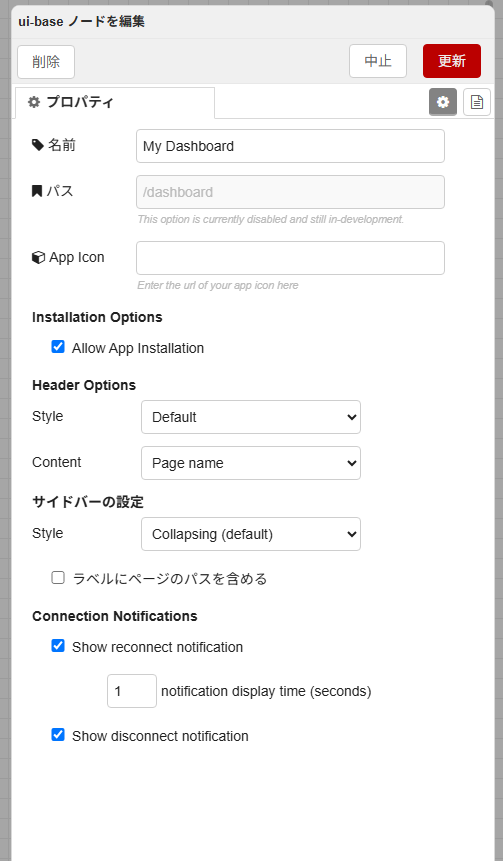

# Node-RED on unkernel

[日本語版](README-ja.md)

[Open the demo](https://utaani.github.io/unkernel-node-red/)


This demo uses [unkernel](https://github.com/pithings/unkernel) to run [Node-RED](https://github.com/node-red/node-red) inside your browser. GitHub Pages serves the files, and the demo opens an empty Node-RED editor. You can try Node-RED without setting up a server.

## Try it out

1. Open the demo in a browser that supports WebAssembly JSPI. We tested the demo in Chromium 156. Desktop Chrome and Edge support JSPI from version 137, Firefox from version 153, and Safari from version 27. The demo requires JSPI to start. [JSPI browser support](https://web-platform-dx.github.io/web-features-explorer/features/wasm-jspi/)
2. Once startup finishes, an empty **Flow 1** appears. The initial download is about 67.6 MiB. In testing, startup took about one to two minutes.
3. Connect an Inject node to a Debug node, deploy the flow, and click the Inject button. A message appears in the Debug sidebar.

Your changes are saved in the session running in that tab. Reloading the entire demo page starts a fresh session. To keep your flows, export them as JSON from the Node-RED menu.

## How it works

- The demo starts unkernel `v0.2.0-261126-fd204d3` in a Web Worker and mounts `alpine.erofs` as the Alpine root filesystem. It loads Node-RED 5.0.10 and Node.js 24.22.3 from a compressed ext4 image.
- The parent page keeps the guest's Web Worker running and opens the Node-RED editor in an iframe with its own URL. The editor loads JavaScript, CSS, and the flow API relative to that URL.
- The service worker forwards HTTP requests under `editor/<session-id>/` to the tab that started the guest. The parent page then uses unkernel's `vm.fetch()` to send them to Node-RED in the guest. The editor receives live notifications from the guest's WebSocket through HTTP polling.
- **Reload editor** reloads the iframe. The guest keeps running, so deployed flows and installed nodes remain available. Deploy or export any pending edits first.
- The repository root contains the static site files. To try the demo locally, run `python3 -m http.server 18883 --bind 127.0.0.1` from the checkout and open `http://127.0.0.1:18883/`. GitHub Pages serves the demo over HTTPS.

## Guest terminal

Click **Terminal** at the top of the demo to open a shell in the running guest. For example, run `uname -m` to check the guest architecture. Click **Close** to return to the editor.

## Connect the guest to the internet through a Wisp relay

The demo starts offline by default. Set `?wisp=` in the demo URL to connect the guest to external services through a Wisp relay. For example, you can call an external API with an HTTP Request node or install nodes from the npm registry using **Manage palette**. The relay's configuration determines which destinations the guest can reach. [Wisp protocol and relay implementations](https://github.com/MercuryWorkshop/wisp-protocol)

### 1. Start a Wisp relay on the host OS running your browser

On the host running your browser, open a terminal with Node.js and npm available. In Windows PowerShell, run the following command to start the Wisp relay. On macOS or Linux, use `npx` in place of `npx.cmd`. [wisp-js documentation](https://github.com/MercuryWorkshop/wisp-js#server-cli)

```powershell
npx.cmd --yes --package=@mercuryworkshop/wisp-js@0.5.3 wisp-js-server --host 127.0.0.1 --port 18887
```

### 2. Open the demo with the relay URL

Leave the relay running and open this URL in a browser on the same host.

<https://utaani.github.io/unkernel-node-red/?wisp=ws%3A%2F%2F127.0.0.1%3A18887%2F>

This URL passes the percent-encoded relay address `ws://127.0.0.1:18887/` in the `wisp` query parameter. If you change the port or address, update the parameter accordingly. Use `ws://` for loopback addresses and `wss://` for relays on another host.

To test the connection, wire an Inject node to an HTTP Request node and then to a Debug node. Set the HTTP Request node to the HTTPS URL of an external service, deploy the flow, and click Inject. Check the response in the Debug sidebar. To stop the relay, press `Ctrl+C` in the terminal where it is running.

To reduce npm download timeouts observed over Wisp, the demo lowers npm's concurrent connection limit from 15 to 4 per origin in sessions that use Wisp.

## Custom nodes and settings

- **With Wisp**, use **Manage palette** to search for and install npm packages.
- **Without Wisp**, use **Manage palette** to upload an npm package as a `.tgz` file. If it has dependencies, bundle them or install them first, starting with the packages they depend on.

Installed nodes are lost when you reload the entire demo page.

The bundled [settings.js](settings.js) disables the welcome tours. Changing these settings requires rebuilding the guest image.

## Try an HTTP In node

Configure an HTTP In node for `GET /test`, wire it through a Template node or similar to set the response body, then wire it to an HTTP Response node and deploy.

Inside the guest, `http://localhost:1880/api/test` points to Node-RED. In the same browser, request `api/test` relative to the editor's URL to reach the HTTP In node through the service worker. After deploying, run this in the browser's developer console on the top-level demo page.

```js
const editor = document.querySelector('iframe');
const response = await fetch(new URL('api/test', editor.src));
console.log(response.status, await response.text());
```

A request to `/api/test` directly under the GitHub Pages project URL goes to the static host. To call the endpoint as a webhook from another device or an external service, run the flow in an environment that accepts incoming requests.

## Try a dashboard

1. Start the demo with Wisp and use **Manage palette** to install `@flowfuse/node-red-dashboard` (FlowFuse Dashboard 2).
2. Wire an Inject node to a Dashboard `text` node. Assign the widget to a page and group, and set the dashboard base path to `/dashboard`. Enable **Allow App Installation** in the dashboard settings before deploying.
3. Click **Open Dashboard** at the top of the demo to open the dashboard from the same guest in a new tab. Keep the demo tab open and click Inject to see the dashboard update.



With this setting off, FlowFuse Dashboard 2 v1.37.0 unregisters service workers on the same origin. This can leave the editor showing a 404 after you close the dashboard tab. In testing on Windows, enabling the setting prevented the 404. If the editor already shows a 404, click **Reload editor** at the top of the demo to reconnect to the current guest session.

In a Windows test using the Node.js Wisp relay, FlowFuse Dashboard 2 appeared in the palette about 5 minutes and 10 seconds after a single click on **Install**. Installation time may vary with network and relay conditions and the CPU and memory available to the unkernel guest in the browser.

In this demo, **Manage palette** waits up to two minutes for the installation request to return. npm may keep running inside the guest after the request times out. Click **Install** once and wait for the result in the event log or the palette before trying again.

The top-level button opens `editor/<session-id>/api/dashboard/` for the current session. If you use a different base path, edit the part after `/api/` in the new tab's URL. The **Open Dashboard** button in the Dashboard 2 sidebar opens a URL without the session ID, which returns a GitHub Pages 404 in this demo.


The screenshot shows the Node-RED editor and dashboard side by side using Microsoft Edge’s split screen feature.

## Current limitations on GitHub Pages

- **Public HTTP In endpoints and dashboard URLs.** GitHub Pages serves static files. The guest handling these requests runs in the browser session that launched the demo. Wisp provides outbound connections from the guest.
- **Guest internet access without Wisp.** Calling external APIs and installing nodes from the npm registry require a configured Wisp relay.

## Warranty

This demo is provided without warranty and is hosted within the [GitHub Pages usage limits](https://docs.github.com/en/pages/getting-started-with-github-pages/github-pages-limits).

## Licenses

The license for this demo's own code is under consideration. Bundled third-party software is subject to its own licenses.

| Distributed file | License and upstream project |
| --- | --- |
| unkernel JavaScript SDK in `sdk/` | MIT. [unkernel MIT license](https://github.com/pithings/unkernel/blob/fd204d3/LICENSE-MIT) |
| `sdk/unkernel.wasm` | The unkernel Linux kernel component is GPL-2.0-only. [unkernel GPL license](https://github.com/pithings/unkernel/blob/fd204d3/LICENSE) · [Upstream revision](https://github.com/pithings/unkernel/tree/fd204d3) |
| `alpine.erofs` | Alpine userspace for AArch64. [Upstream release](https://github.com/pithings/unkernel/releases/tag/v0.2.0-261126-fd204d3) |
| `node-red.kwsparse.gz` | Includes [Node-RED (Apache-2.0)](https://github.com/node-red/node-red/blob/main/LICENSE), [Node.js and bundled components](https://github.com/nodejs/node/blob/v24.22.3/LICENSE), Alpine libraries, and npm dependencies. |
| xterm.js and the fit addon in `terminal/` | MIT. [xterm.js license](terminal/LICENSE-xterm) · [Fit addon license](terminal/LICENSE-addon-fit) |

Third-party license texts, copyright notices, NOTICE files, and the way to make corresponding source available for GPL-covered binaries are under review. The links above identify the upstream projects and versions used.
